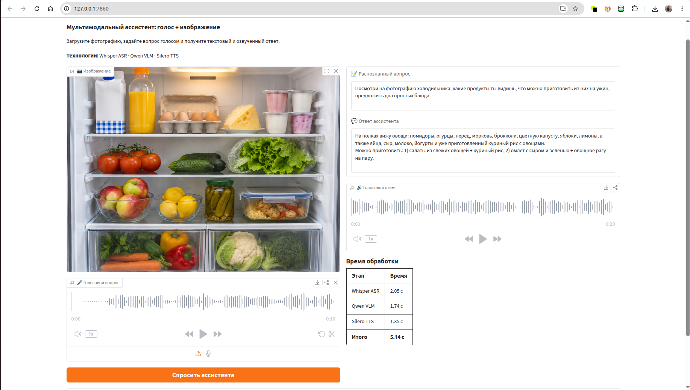
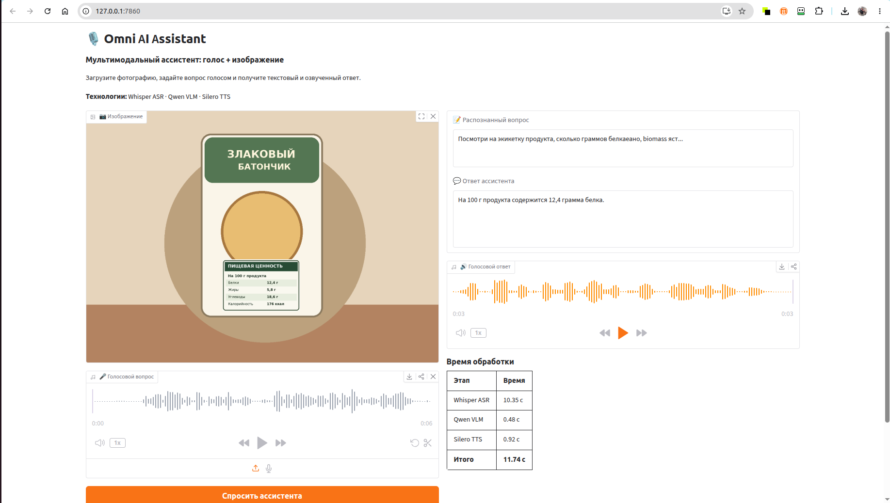
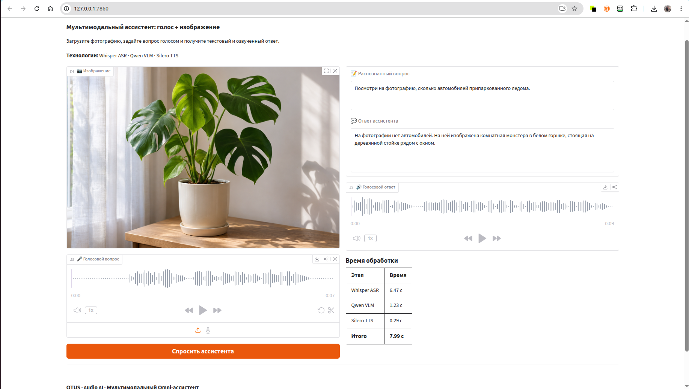

# Omni AI Assistant — голосовой мультимодальный ассистент



Учебный проект по курсу **OTUS LLM Engineering / Audio AI**. Ассистент принимает изображение и голосовой вопрос на русском языке, распознаёт речь, анализирует изображение с учётом вопроса и генерирует голосовой ответ. Предусмотрены Gradio-интерфейс, сохранение результатов экспериментов и измерение задержек.

> **Важное отличие от задания:** вместо локальной **Qwen3-VL-4B/8B-Instruct в 4-bit** использована **облачная Qwen3.6-35B** через Yandex AI Studio (Responses API). Требование локального запуска VLM и 4-битного квантования не выполнено. Whisper и Silero работают локально на CPU. Эта архитектура — функциональная адаптация задания под доступное оборудование.

## Возможности

- **Whisper base (CPU):** ASR, расшифровка голосового вопроса на русском языке.
- **Qwen3.6-35B (Yandex AI Studio):** VLM, совместный анализ изображения и распознанного вопроса.
- **Silero TTS v5_ru / aidar (CPU):** генерация WAV с голосовым ответом.
- **Gradio:** интерфейс с загрузкой фотографии, записью/загрузкой звука, транскрипцией, ответом, плеером и таймингами.
- **Исследование:** шесть сценариев, тесты шума (SNR 15 и 5 dB), мелкой этикетки, отсутствующих объектов; результаты сохраняются в JSON и анализируются в Notebook.

## Архитектура

```text
Изображение ───────────────────────┐
                                   ▼
Аудиовопрос → Whisper ASR → текст → Qwen VLM → ответ → Silero TTS → WAV
                                                │                   │
                                                └──── Gradio ───────┘
```

Основные файлы: `pipeline.py` (оркестратор), `app.py` (Gradio), `evaluate.py` (сохранение экспериментов), `noise_test.py` (ASR с шумом), `omni_assistant_experiments.ipynb` (отчёт и демонстрация).

## Установка и запуск

Проверено в проекте на Ubuntu, Python 3.12; обязателен `ffmpeg`. Потребуются интернет-доступ для Yandex AI Studio, API-ключ и предварительно загруженные файлы моделей. Пример установки:

```bash
sudo apt-get install ffmpeg
uv venv --python 3.12
source .venv/bin/activate
uv pip install -r requirements.txt
cp .env.example .env
```

Заполните `.env` своими значениями и **не добавляйте его в Git**. Whisper скачивается при первом обращении. В актуальном `pipeline.py` Silero загружается **из локального кэша Torch Hub** (`~/.cache/torch/hub/snakers4_silero-models_master`); требуется однократная предварительная загрузка Silero через Torch Hub или адаптация пути под свою систему.

```bash
python app.py
```

Откройте `http://127.0.0.1:7860`. Приложение сохраняет каждый новый WAV под уникальным UUID, не перезаписывая предыдущие результаты.

## Эксперименты

| Сценарий | Цель |
|---|---|
| `fridge_baseline` | Базовая проверка сквозного ASR → VLM → TTS |
| `fridge_noisy_15db` | Сохранение смысла при умеренном шуме |
| `fridge_noisy_5db` | Устойчивость к сильному шуму |
| `nutrition_full` | Чтение мелкого текста на упаковке |
| `nutrition_zoom` | Сравнение с увеличенной этикеткой |
| `plant_hallucination` | Отказ от описания отсутствующих автомобилей |

Каждый запуск `evaluate.py` сохраняет `result.json`, копию изображения, исходный аудиовопрос и `answer.wav` в собственной папке. Для проверки полного набора нужны примеры из `samples/` и два WAV из `experiments/results/asr_noise/`.

```bash
python evaluate.py --name fridge_baseline --image samples/images/fridge.png --audio samples/audio/fridge_question.ogg
python evaluate.py --name fridge_noisy_15db --image samples/images/fridge.png --audio experiments/results/asr_noise/snr_15db.wav
python evaluate.py --name fridge_noisy_5db --image samples/images/fridge.png --audio experiments/results/asr_noise/snr_5db.wav
python evaluate.py --name nutrition_full --image samples/images/nutrition_full.png --audio samples/audio/nutrition_question.ogg
python evaluate.py --name nutrition_zoom --image samples/images/nutrition_zoom.png --audio samples/audio/nutrition_question.ogg
python evaluate.py --name plant_hallucination --image samples/images/plant.png --audio samples/audio/plant_question.ogg
```

Откройте `omni_assistant_experiments.ipynb`, выберите ядро `.venv` и выполните **Run All**. Notebook автоматически читает сохранённые JSON, показывает **входные файлы → распознанный текст → ответ → аудио**, строит графики задержек. Дополнительная ячейка позволяет сделать **новый платный API-вызов** по желанию (по умолчанию выключена).

## Итоги и ограничения

- Мультимодальная модель в отдельных испытаниях правильно интерпретировала частично искажённый голосовой вопрос; при SNR 5 dB смысл терялся.
- Таблица с пищевой ценностью прочитана правильно как на полном изображении, так и после увеличения: **12,4 г белка на 100 г**.
- В тесте с растением модель не выдумала отсутствующие автомобили.
- В некоторых запусках **Whisper занимала большую часть общей задержки**, иногда более восьми секунд; для реального голосового UX нужна оптимизация ASR.
- Измерения получены в небольшом числе запусков; они не являются статистическим бенчмарком. WER без ручной эталонной транскрипции не рассчитывается.
- Шум генерируется программно; не проверены уличные/речевые помехи в разнообразных условиях. Облачная VLM зависит от сети и платного API.
- В текущей реализации **нет отдельного этапа шумоподавления** перед ASR, хотя исходное ТЗ рекомендует его.

Подробности — в [отчёте](REPORT.md) и [Notebook](omni_assistant_experiments.ipynb).

## Скриншоты

| Холодильник | Этикетка | Галлюцинации |
|---|---|---|
|  |  |  |

## Безопасность и публикация

Не публикуйте `.env`, API-ключи, виртуальное окружение и полный локальный кэш моделей. Перед публикацией **просмотрите аудиозаписи и изображения**: они могут содержать личную информацию. Финальные результаты следует включать выборочно, чтобы не публиковать дубли и промежуточные файлы.
